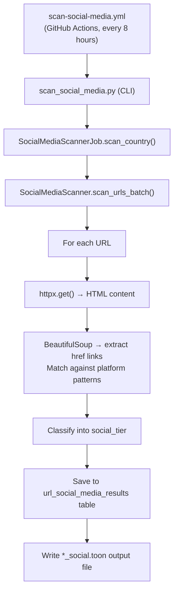

> **Method change, November 2026.** Until this change, any link whose address
> contained `/@name` was counted as Mastodon. TikTok, YouTube, Threads, Medium
> and Substack use the same pattern, so their links were counted as Mastodon
> too. That overstated Mastodon use and raised Digital Sovereignty Scores.
> Results stored before the change are corrected automatically, and TikTok,
> YouTube, Blacksky and Gander are now tracked as platforms of their own.
> TikTok and YouTube counts stay incomplete until every page has been
> rescanned, because older scans kept only the TikTok and YouTube links that
> used `/@name`.
>
> **Counting change, November 2026.** Figures used to count a page under a
> platform if any scan had ever found a link, so a government that left a
> platform still counted as using it. Each page is now counted as of its most
> recent successful scan. A scan that fails, or returns an error page such as
> a 404, is not treated as the page dropping its links.

<!-- SOCIAL_MEDIA_STATS_START -->

<div id="sm-tier-pie-container" style="float:right;margin:0 0 1rem 1.5rem;width:260px;max-width:45%;">
<svg role="img" aria-labelledby="pie-title pie-desc" viewBox="0 0 240 314" width="240" height="314" xmlns="http://www.w3.org/2000/svg">
<title id="pie-title">Social media tier distribution</title>
<desc id="pie-desc">Pie chart: social media tier distribution across 87,696 scanned pages. Legacy only: 31,870 (36.3%), Modern only: 153 (0.2%), Mixed: 1,110 (1.3%), No Social: 49,108 (56.0%)</desc>
<path d="M 120,110 L 120.000,20.000 A 90,90 0 0,1 178.442,178.444 Z" fill="#1a8cd8" stroke="#fff" stroke-width="1"><title>Twitter/X only: 31,870 (38.8%)</title></path>
<path d="M 120,110 L 178.442,178.444 A 90,90 0 0,1 177.638,179.122 Z" fill="#0085ff" stroke="#fff" stroke-width="1"><title>Modern only: 153 (0.2%)</title></path>
<path d="M 120,110 L 177.638,179.122 A 90,90 0 0,1 171.576,183.756 Z" fill="#7856ff" stroke="#fff" stroke-width="1"><title>Mixed: 1,110 (1.3%)</title></path>
<path d="M 120,110 L 171.576,183.756 A 90,90 0 1,1 120.000,20.000 Z" fill="#cccccc" stroke="#fff" stroke-width="1"><title>No Social: 49,108 (59.7%)</title></path>
<rect x="20" y="216" width="14" height="14" fill="#1a8cd8"/>
<text x="40" y="227" font-size="11" font-family="sans-serif" fill="#333">Twitter/X only (38.8%)</text>
<rect x="20" y="238" width="14" height="14" fill="#0085ff"/>
<text x="40" y="249" font-size="11" font-family="sans-serif" fill="#333">Modern only (0.2%)</text>
<rect x="20" y="260" width="14" height="14" fill="#7856ff"/>
<text x="40" y="271" font-size="11" font-family="sans-serif" fill="#333">Mixed (1.3%)</text>
<rect x="20" y="282" width="14" height="14" fill="#cccccc"/>
<text x="40" y="293" font-size="11" font-family="sans-serif" fill="#333">No Social (59.7%)</text>
</svg>
<p style="text-align:center;font-size:0.75em;margin:0.3rem 0 0;color:#555;font-style:italic;">Social media tier distribution</p>
</div>

_Stats as of 2026-11-11 18:02 UTC — last scan: 2026-11-11_

**403** scan batches run

**87,690** of **87,696** available pages scanned (**100.0%** coverage)
**82,235** of **87,690** scanned pages were reachable (**93.8%**)

**Legacy social media** (older, centralised platforms):

| Platform | Pages with link | % of scanned | % of reachable |
|----------|----------------|:------------:|:--------------:|
| 🐦 Twitter | **13,651** | 15.6% | 16.6% |
| ✖ X | **3,793** | 4.3% | 4.6% |
| 👍 Facebook | **29,282** | 33.4% | 35.6% |
| 💼 LinkedIn | **10,666** | 12.2% | 13.0% |
| TikTok | **1,628** | 1.9% | 2.0% |
| YouTube | **4,431** | 5.1% | 5.4% |

**Modern / open social media** (decentralised or open platforms):

| Platform | Pages with link | % of scanned | % of reachable |
|----------|----------------|:------------:|:--------------:|
| 🦋 Bluesky | **860** | 1.0% | 1.0% |
| Blacksky | **0** | 0.0% | 0.0% |
| Gander | **0** | 0.0% | 0.0% |
| 🐘 Mastodon / Fediverse | **501** | 0.6% | 0.6% |

<div style="clear:both;"></div>

📥 Machine-readable results are available as the [social-media-data.json artifact (machine-readable JSON)](https://github.com/mgifford/eu-plus-government-scans/actions/workflows/generate-scan-progress.yml).

---

## Digital Sovereignty Rankings

Countries ranked by **Digital Sovereignty Score**: the percentage of reachable pages using *no social media* or *modern open platforms only* (Mastodon, Bluesky, Blacksky, Gander).  A higher score means fewer links to centralised corporate social-media platforms (Twitter / X, Facebook, LinkedIn, TikTok, YouTube).  Pages with no social-media links at all score highest; pages linking only to open platforms also rank well.  **Legacy Exposure** shows the percentage of reachable pages that still link to at least one of those corporate platforms.

| Rank | Country | Sovereignty Score | No Social | Modern Only | Legacy Exposure | Tier |
|------|---------|:-----------------:|:---------:|:-----------:|:---------------:|------|
| 1 | Finland | 76.7% | 145 | 0 | 23.3% | 🥉 Growing |
| 2 | Norway | 75.8% | 183 | 2 | 24.2% | 🥉 Growing |
| 3 | Lithuania | 74.6% | 85 | 0 | 25.4% | 🥉 Growing |
| 4 | Iceland | 72.7% | 104 | 0 | 27.3% | 🥉 Growing |
| 5 | Malta | 71.9% | 428 | 0 | 28.1% | 🥉 Growing |
| 6 | Canada | 68.8% | 2,939 | 4 | 31.2% | 🥉 Growing |
| 7 | Germany | 67.8% | 4,364 | 47 | 32.2% | 🥉 Growing |
| 8 | Portugal | 67.1% | 2,160 | 1 | 32.9% | 🥉 Growing |
| 9 | France | 66.7% | 6,206 | 15 | 33.3% | 🥉 Growing |
| 10 | Greece | 65.8% | 1,080 | 1 | 34.2% | 🥉 Growing |
| 11 | Netherlands | 64.8% | 583 | 10 | 35.2% | 🥉 Growing |
| 12 | Switzerland | 64.3% | 1,328 | 13 | 35.7% | 🥉 Growing |
| 13 | Denmark | 63.0% | 951 | 0 | 37.0% | 🥉 Growing |
| 14 | Sweden | 62.8% | 1,023 | 1 | 37.2% | 🥉 Growing |
| 15 | United Kingdom | 62.8% | 11,764 | 7 | 37.2% | 🥉 Growing |
| 16 | Slovenia | 62.5% | 130 | 0 | 37.5% | 🥉 Growing |
| 17 | Romania | 62.2% | 216 | 3 | 37.8% | 🥉 Growing |
| 18 | Czechia | 62.1% | 499 | 0 | 37.9% | 🥉 Growing |
| 19 | Slovakia | 61.2% | 256 | 0 | 38.8% | 🥉 Growing |
| 20 | Belgium | 58.7% | 723 | 4 | 41.3% | 🥉 Growing |
| 21 | Croatia | 58.7% | 149 | 0 | 41.3% | 🥉 Growing |
| 22 | Hungary | 57.5% | 220 | 2 | 42.5% | 🥉 Growing |
| 23 | Spain | 57.1% | 3,071 | 2 | 42.9% | 🥉 Growing |
| 24 | Bulgaria | 56.7% | 173 | 0 | 43.3% | 🥉 Growing |
| 25 | Austria | 52.2% | 412 | 0 | 47.8% | 🥉 Growing |
| 26 | Estonia | 50.3% | 193 | 0 | 49.7% | 🥉 Growing |
| 27 | Poland | 48.7% | 6,721 | 36 | 51.3% | 🥉 Growing |
| 28 | Cyprus | 48.3% | 14 | 0 | 51.7% | 🥉 Growing |
| 29 | Ireland | 47.1% | 236 | 0 | 52.9% | 🥉 Growing |
| 30 | Luxembourg | 45.5% | 247 | 0 | 54.5% | 🥉 Growing |
| 31 | Italy | 45.4% | 2,206 | 5 | 54.6% | 🥉 Growing |
| 32 | Latvia | 39.0% | 299 | 0 | 61.0% | ⚠️ Legacy-heavy |

---

## Social Media Scan by Country

**Available**: all government pages tracked in our domain list. **Reachable**: of those scanned, pages that returned a valid HTTP response (not an error or timeout). **Sov. Score**: Digital Sovereignty Score — % of reachable pages with no social media or modern-only social presence. Tier columns classify each page by its overall social media presence; platform columns count pages with at least one link to that platform, so a page may appear in more than one platform column. Both describe each page as of its most recent successful scan: a page that removed a link no longer counts, and a failed scan leaves the page as it was last seen.

| Country | Scanned | Available | Reachable | Sov. Score | No Social | Legacy-only | Twitter | X | Facebook | LinkedIn | TikTok | YouTube | Modern | Mixed | Bluesky | Blacksky | Gander | Mastodon | Scan Period |
|---------|---------|-----------|-----------|:----------:|-----------|-------------|---------|---|----------|----------|--------|---------|--------|-------|---------|----------|--------|----------|-------------|
| Austria | 822 | 822 | 789 | 52.2% | 412 | 359 | 32 | 24 | 351 | 187 | 19 | 258 | 0 | 18 | 18 | 0 | 0 | 0 | Aug 2026 – Nov 2026 |
| Belgium | 1,329 | 1,329 | 1,239 | 58.7% | 723 | 468 | 162 | 76 | 457 | 332 | 21 | 159 | 4 | 44 | 26 | 0 | 0 | 22 | Aug 2026 – Nov 2026 |
| Bulgaria | 353 | 353 | 305 | 56.7% | 173 | 132 | 22 | 6 | 114 | 11 | 2 | 63 | 0 | 0 | 0 | 0 | 0 | 0 | Aug 2026 – Nov 2026 |
| Canada | 4,469 | 4,469 | 4,279 | 68.8% | 2,939 | 1,288 | 458 | 144 | 1,232 | 575 | 20 | 140 | 4 | 48 | 51 | 0 | 0 | 1 | Aug 2026 – Oct 2026 |
| Croatia | 257 | 257 | 254 | 58.7% | 149 | 105 | 47 | 15 | 98 | 35 | 22 | 68 | 0 | 0 | 0 | 0 | 0 | 0 | Aug 2026 – Nov 2026 |
| Czechia | 866 | 866 | 804 | 62.1% | 499 | 305 | 129 | 32 | 277 | 40 | 0 | 123 | 0 | 0 | 0 | 0 | 0 | 0 | Aug 2026 – Nov 2026 |
| Denmark | 1,536 | 1,536 | 1,509 | 63.0% | 951 | 541 | 157 | 18 | 451 | 324 | 0 | 35 | 0 | 17 | 17 | 0 | 0 | 0 | Aug 2026 – Nov 2026 |
| Estonia | 401 | 401 | 384 | 50.3% | 193 | 191 | 52 | 5 | 183 | 71 | 3 | 113 | 0 | 0 | 0 | 0 | 0 | 0 | Aug 2026 – Nov 2026 |
| Finland | 199 | 199 | 189 | 76.7% | 145 | 43 | 11 | 6 | 31 | 34 | 0 | 25 | 0 | 1 | 1 | 0 | 0 | 0 | Aug 2026 – Nov 2026 |
| France | 10,009 | 10,009 | 9,321 | 66.7% | 6,206 | 2,965 | 1,465 | 620 | 2,701 | 1,709 | 214 | 325 | 15 | 135 | 131 | 0 | 0 | 36 | Aug 2026 – Nov 2026 |
| Germany | 6,599 | 6,599 | 6,502 | 67.8% | 4,364 | 1,846 | 1,101 | 197 | 1,641 | 643 | 141 | 237 | 47 | 245 | 137 | 0 | 0 | 226 | Aug 2026 – Oct 2026 |
| Greece | 1,752 | 1,752 | 1,643 | 65.8% | 1,080 | 561 | 230 | 68 | 539 | 128 | 13 | 112 | 1 | 1 | 0 | 0 | 0 | 2 | Aug 2026 – Oct 2026 |
| Hungary | 392 | 392 | 386 | 57.5% | 220 | 164 | 29 | 0 | 155 | 15 | 21 | 92 | 2 | 0 | 0 | 0 | 0 | 2 | Aug 2026 – Nov 2026 |
| Iceland | 145 | 145 | 143 | 72.7% | 104 | 39 | 6 | 6 | 39 | 7 | 6 | 14 | 0 | 0 | 0 | 0 | 0 | 0 | Aug 2026 – Nov 2026 |
| Ireland | 536 | 536 | 501 | 47.1% | 236 | 247 | 152 | 40 | 221 | 111 | 22 | 166 | 0 | 18 | 15 | 0 | 0 | 3 | Aug 2026 – Nov 2026 |
| Italy | 5,351 | 5,351 | 4,874 | 45.4% | 2,206 | 2,645 | 1,997 | 148 | 2,524 | 580 | 44 | 262 | 5 | 18 | 0 | 0 | 0 | 23 | Aug 2026 – Nov 2026 |
| Latvia | 803 | 803 | 767 | 39.0% | 299 | 457 | 283 | 59 | 450 | 177 | 26 | 61 | 0 | 11 | 5 | 0 | 0 | 6 | Aug 2026 – Oct 2026 |
| Lithuania | 122 | 122 | 114 | 74.6% | 85 | 29 | 2 | 4 | 29 | 18 | 0 | 20 | 0 | 0 | 0 | 0 | 0 | 0 | Aug 2026 – Nov 2026 |
| Luxembourg | 573 | 573 | 543 | 45.5% | 247 | 155 | 176 | 9 | 266 | 231 | 14 | 63 | 0 | 141 | 141 | 0 | 0 | 3 | Aug 2026 – Nov 2026 |
| Malta | 610 | 610 | 595 | 71.9% | 428 | 167 | 47 | 15 | 158 | 70 | 10 | 53 | 0 | 0 | 0 | 0 | 0 | 0 | Aug 2026 – Nov 2026 |
| Netherlands | 945 | 945 | 915 | 64.8% | 583 | 258 | 107 | 85 | 279 | 210 | 7 | 160 | 10 | 64 | 46 | 0 | 0 | 33 | Aug 2026 – Nov 2026 |
| Norway | 249 | 249 | 244 | 75.8% | 183 | 59 | 9 | 13 | 40 | 45 | 0 | 16 | 2 | 0 | 0 | 0 | 0 | 2 | Aug 2026 – Nov 2026 |
| Poland | 14,951 | 14,951 | 13,882 | 48.7% | 6,721 | 7,075 | 1,017 | 342 | 6,993 | 813 | 535 | 702 | 36 | 50 | 1 | 0 | 0 | 85 | Aug 2026 – Nov 2026 |
| Portugal | 3,508 | 3,508 | 3,219 | 67.1% | 2,160 | 1,051 | 343 | 84 | 999 | 253 | 42 | 152 | 1 | 7 | 2 | 0 | 0 | 6 | Aug 2026 – Oct 2026 |
| Cyprus | 29 | 29 | 29 | 48.3% | 14 | 15 | 9 | 1 | 15 | 3 | 0 | 13 | 0 | 0 | 0 | 0 | 0 | 0 | Aug 2026 – Nov 2026 |
| Romania | 807 | 807 | 352 | 62.2% | 216 | 133 | 40 | 8 | 133 | 16 | 5 | 6 | 3 | 0 | 0 | 0 | 0 | 3 | Aug 2026 – Oct 2026 |
| Slovakia | 442 | 442 | 418 | 61.2% | 256 | 161 | 19 | 12 | 154 | 62 | 10 | 77 | 0 | 1 | 1 | 0 | 0 | 0 | Aug 2026 – Nov 2026 |
| Slovenia | 214 | 214 | 208 | 62.5% | 130 | 77 | 24 | 7 | 68 | 12 | 6 | 47 | 0 | 1 | 1 | 0 | 0 | 0 | Aug 2026 – Nov 2026 |
| Spain | 6,091 | 6,091 | 5,386 | 57.1% | 3,071 | 2,233 | 1,618 | 501 | 1,763 | 538 | 160 | 202 | 2 | 80 | 72 | 0 | 0 | 10 | Aug 2026 – Nov 2026 |
| Sweden | 1,702 | 1,702 | 1,631 | 62.8% | 1,023 | 593 | 82 | 21 | 506 | 419 | 26 | 20 | 1 | 14 | 14 | 0 | 0 | 1 | Aug 2026 – Oct 2026 |
| Switzerland | 2,123 | 2,123 | 2,085 | 64.3% | 1,328 | 672 | 213 | 226 | 240 | 563 | 12 | 189 | 13 | 72 | 55 | 0 | 0 | 32 | Aug 2026 – Nov 2026 |
| United Kingdom | 19,511 | 19,511 | 18,731 | 62.8% | 11,764 | 6,836 | 3,618 | 1,007 | 6,181 | 2,434 | 227 | 460 | 7 | 124 | 126 | 0 | 0 | 5 | Aug 2026 – Nov 2026 |
| **Total** | **87,696** | **87,696** | **82,241** | **59.9%** | **49,108** | **31,870** | **13,657** | **3,799** | **29,288** | **10,666** | **1,628** | **4,433** | **153** | **1,110** | **860** | **0** | **0** | **501** | — |

> Hover or focus any non-zero country-table count to preview matching pages. Activate the number to keep the preview open. Full machine-readable data is available as the [social-media-data.json artifact (machine-readable JSON)](https://github.com/mgifford/eu-plus-government-scans/actions/workflows/generate-scan-progress.yml).

<!-- SOCIAL_MEDIA_STATS_END -->

---

## Overview

The social media scanner fetches each government page and inspects the HTML for
links to known social platforms. Results are stored in the metadata database
and published to this site via the [Scan Progress Report](scan-progress.md).

Scans run **automatically every 8 hours** via GitHub Actions so that the full
set of ~88,000 URLs across 32 countries can be covered gradually without
overloading government servers.

---

## Platforms Tracked

### Legacy Social Media (older, centralised platforms)

| Platform | Domains detected |
|----------|-----------------|
| **Twitter** | `twitter.com` |
| **X** | `x.com` |
| **Facebook** | `facebook.com`, `fb.com` |
| **LinkedIn** | `linkedin.com` |
| **TikTok** | `tiktok.com`, `m.tiktok.com`, `vm.tiktok.com` |
| **YouTube** | `youtube.com`, `m.youtube.com`, `youtu.be` |

### Modern / Open Social Media (decentralised or open platforms)

| Platform | Domains detected |
|----------|-----------------|
| **Bluesky** | `bsky.app`, `bsky.social` |
| **Blacksky** | `blacksky.community` (an AT Protocol app, like Bluesky) |
| **Gander** | `gander.social`, `gandersocial.ca` (a Canadian AT Protocol app) |
| **Mastodon / Fediverse** | 40+ known instances + `/@username` pattern detection |

The `/@username` pattern is only applied to hosts that are not listed above.
Threads, Medium and Substack also use `/@username` addresses but are not
counted as Mastodon. Threads lets some accounts federate with Mastodon, but it
is run by Meta, so it is not treated as an open platform.

---

## Tier Classification

Each scanned page is assigned one of five tiers:

| Tier | Meaning |
|------|---------|
| `unreachable` | Page could not be fetched (network error, timeout, 4xx/5xx) |
| `no_social` | Page is reachable but contains no recognised social media links |
| `twitter_only` | Page links only to legacy platforms (Twitter, X, Facebook, LinkedIn, TikTok or YouTube) |
| `modern_only` | Page links only to modern / open platforms (Bluesky, Blacksky, Gander or Mastodon) |
| `mixed` | Page links to at least one legacy platform **and** at least one modern platform |

---

## Viewing Results

### Scan Progress Report

The **[Scan Progress Report](scan-progress.md)** is regenerated after every
scan and shows per-country breakdowns including:

- Total URLs scanned and reachable count
- Tier distribution (twitter-only / modern / mixed / no-social / unreachable)
- Per-platform link counts (Twitter, X, Bluesky, Mastodon)
- Date range showing when each country was last scanned

### GitHub Actions Artifacts

Each workflow run also uploads a scan artifact containing:

- `data/metadata.db` — the full SQLite results database
- `social-scan-output.txt` — the raw scan log
- `data/toon-seeds/countries/**_social.toon` — annotated TOON files

To download artifacts:

1. Go to [GitHub Actions → Scan Social Media Links](https://github.com/mgifford/eu-plus-government-scans/actions/workflows/scan-social-media.yml)
2. Click on the relevant workflow run
3. Scroll to the **Artifacts** section at the bottom of the run summary page
4. Download `social-scan-<run_number>` to inspect the database or TOON files

---

## Running a Scan Manually

### Via GitHub Actions (recommended)

1. Go to [Actions → Scan Social Media Links](https://github.com/mgifford/eu-plus-government-scans/actions/workflows/scan-social-media.yml)
2. Click **Run workflow**
3. Optionally enter a country code (e.g. `ICELAND`) or leave blank to scan all
4. Optionally adjust the rate limit (default: 1.0 req/sec)

### Via the command line

```bash
# Scan a single country
python3 -m src.cli.scan_social_media --country ICELAND --rate-limit 1.0

# Scan all countries (with a 110-minute runtime cap)
python3 -m src.cli.scan_social_media --all --max-runtime 110 --rate-limit 1.0
```

---

## Output Format

### Annotated TOON file (`*_social.toon`)

Each scanned page entry gains a `social_media` field. A page that could not be
fetched gets a `social_media_error` field holding the error message instead.

```json
{
  "url": "https://example.gov/",
  "is_root_page": true,
  "social_media": {
    "tier": "mixed",
    "twitter": ["https://twitter.com/example_gov"],
    "x": [],
    "bluesky": ["https://bsky.app/profile/example.bsky.social"],
    "mastodon": [],
    "facebook": [],
    "linkedin": [],
    "tiktok": [],
    "youtube": [],
    "blacksky": [],
    "gander": []
  }
}
```

### Database table (`url_social_media_results`)

| Column | Type | Description |
|--------|------|-------------|
| `url` | TEXT | Page URL |
| `country_code` | TEXT | Country identifier (e.g. `ICELAND`) |
| `scan_id` | TEXT | Unique scan run identifier |
| `is_reachable` | INTEGER | 1 = reachable, 0 = not reachable |
| `twitter_links` | TEXT | JSON list of `twitter.com` hrefs found |
| `x_links` | TEXT | JSON list of `x.com` hrefs found |
| `facebook_links` | TEXT | JSON list of `facebook.com` / `fb.com` hrefs found |
| `linkedin_links` | TEXT | JSON list of `linkedin.com` hrefs found |
| `tiktok_links` | TEXT | JSON list of TikTok hrefs found |
| `youtube_links` | TEXT | JSON list of YouTube hrefs found |
| `bluesky_links` | TEXT | JSON list of Bluesky hrefs found |
| `blacksky_links` | TEXT | JSON list of Blacksky hrefs found |
| `gander_links` | TEXT | JSON list of Gander hrefs found |
| `mastodon_links` | TEXT | JSON list of Mastodon hrefs found |
| `social_tier` | TEXT | Tier classification (see above) |
| `scanned_at` | TEXT | ISO-8601 timestamp of scan |

---

## Countries Covered

Scans cover all 27 EU member states plus 5 allied nations:

| Region | Countries |
|--------|----------|
| EU member states | Austria, Belgium, Bulgaria, Croatia, Czechia, Denmark, Estonia, Finland, France, Germany, Greece, Hungary, Ireland, Italy, Latvia, Lithuania, Luxembourg, Malta, Netherlands, Poland, Portugal, Republic of Cyprus, Romania, Slovakia, Slovenia, Spain, Sweden |
| Allied nations | Canada, Iceland, Norway, Switzerland, United Kingdom |

See also the **[Government Domains](domains.md)** page for a full listing of
all domains tracked per country.

---

## Architecture


